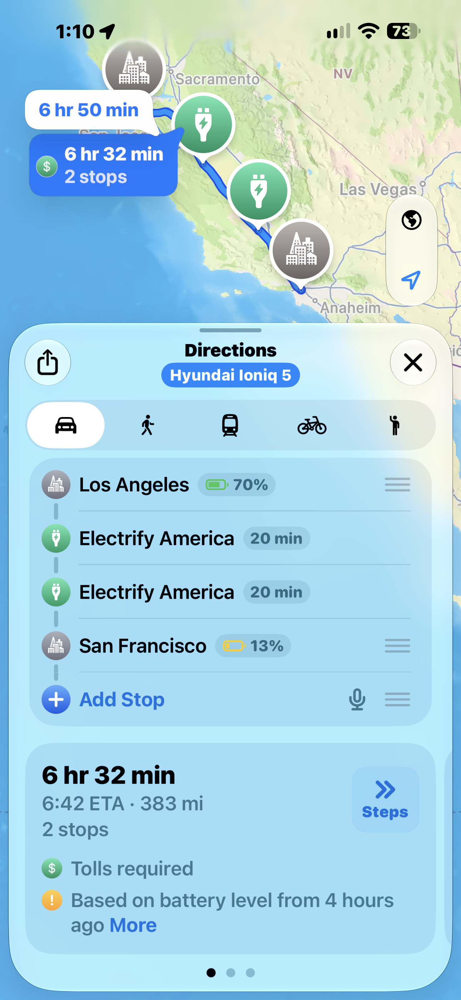

# E-GMP CarPlay EV Routing

Experimental Apple Maps EV routing for Gen5W, installed as a **native HMG-API mod**, using **official HMG-API 1.0.0-beta.6 or newer**. Version **0.4.0** is the first experimental release.

## Install

1. Install [NEMESIS](https://github.com/xwtk/hmg_nemesis) and [HMG-API beta6 or newer](https://github.com/VysseCodes/HMG-API/releases). NEMESIS can install HMG-API itself.
2. Install/enable HMG-API’s **Wireless CarPlay + Android Auto** mod, apply, verify the car map and reboot. It is a separate download; confirm CarPlay works.
3. Download **[egmp-carplay-ev-routing-v0.4.0.zip](https://github.com/isaacwisdom/egmp-carplay-ev-routing/releases/download/v0.4.0/egmp-carplay-ev-routing-v0.4.0.zip)** and copy it unchanged into `HMGAPI/updates/` on a USB stick. In HMG-API, use **Check USB updates**, install it, enable it and **Apply changes**. Remove the USB and fully reboot.
4. **Manually delete the existing iPhone–HU pairing and pair again.** Remove the iPhone from the HU’s paired-device list, forget the HU in the iPhone’s Bluetooth and CarPlay settings, then pair again and allow CarPlay. This step is required after installation; reconnecting the existing pairing is not enough.

5. On your iPhone, open Apple Maps, tap your profile picture, then **Vehicles**. Follow the prompts to add your detected vehicle, or select it if it is already listed. See the [illustrated setup steps](docs/INSTALLATION.md#add-your-vehicle-in-apple-maps).

There is **one mod download** for both supported vehicles. HMG-API selects the correct bundled profile when applying the mod and writes one active profile file; the routing code always reads that file. No manual profile choice is needed. [Detailed directions](docs/INSTALLATION.md). The [NEMESIS store rollout is on hold](docs/NEMESIS-RELEASE.md) pending investigation and HU verification of upstream HMG-API v1.0.0 issues. Our tested HU baseline is beta.6; v1.0.0 has only been checked off the car. The existing native mod installation route remains available.

## Apple Maps EV routing

After adding your vehicle, select it when planning driving directions. Maps can include charging stops and estimated battery levels along the route.

## Supported configurations

| Vehicle | Firmware | Status |
|---|---|---|
| Ioniq 5 US, 77.4 kWh | NEEV23.USA / 260507 | Integration tested on one HU; energy model uncalibrated. |
| Kia EV6 US | CVEV.USA / 260507 | Experimental profile; untested. **Values copied from Ioniq 5, unvalidated and likely inaccurate.** |

Exact native-library hashes and a resolving HMG-API map are required. Other firmware/battery configurations are unsupported, including 260903 until our native integration is validated there.

Live SOC, range and auxiliary power are sent every five seconds while subscribed, with charging/consumption contracts. Energy and full-charge range are estimates. Charging state, active connector and temperature are omitted. Renaming and contract updates are not implemented.

**Known issue:** an owner reports Apple Maps recalculating routes at the five-second update cadence. Update policy and contract-change behavior remain under investigation; this release is experimental.

Logs rotate between two 512 KiB files and can be exported by NEMESIS. The optional NEMESIS wrapper also writes USB install diagnostics; native HMG-API imports do not run that hook.

[Compatibility](docs/COMPATIBILITY.md) · [Contracts](docs/CONTRACTS.md) · [Logs](docs/LOGGING.md) · [Build](docs/BUILDING.md) · [Validation](docs/VALIDATION.md)

## Credits

Special credit to [augard/evmaps](https://github.com/augard/evmaps) for the charging/consumption dictionaries and reference material. Built on [HMG-API](https://github.com/VysseCodes/HMG-API) and NEMESIS, with vehicle-data research from [egmp-aa-ev-feat](https://github.com/willemcvu/egmp-aa-ev-feat). Original code: GPL-3.0-or-later; see [NOTICE](NOTICE.md). No OEM binaries are distributed.
