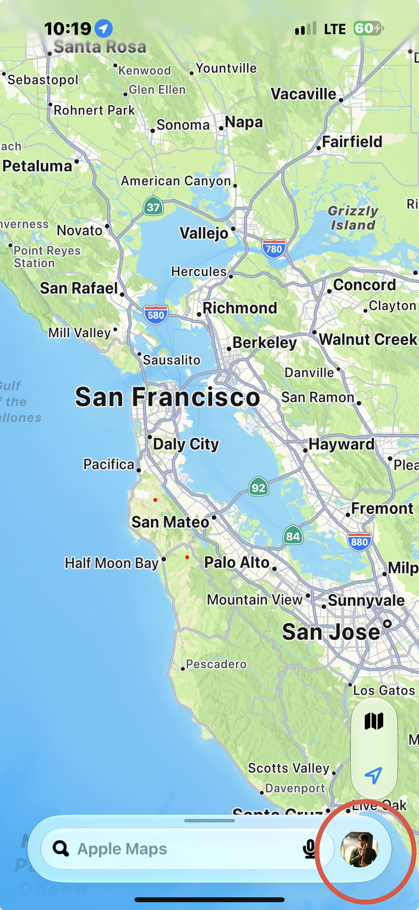
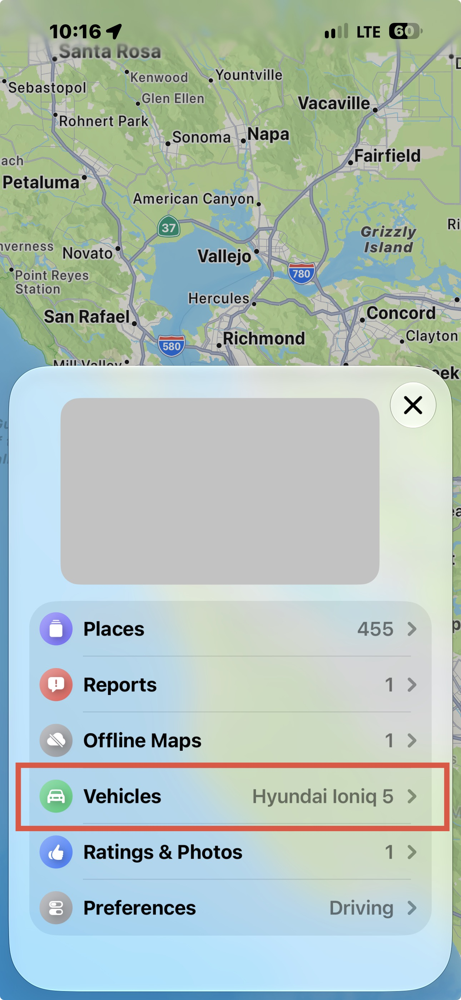
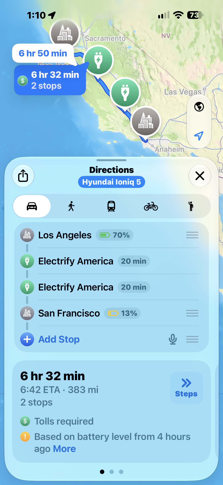

# Installation through HMG-API

Requires official HMG-API **1.0.0-beta.6 or newer**, a checked car map, and its enabled/applied **Wireless CarPlay + Android Auto** mod. HMG-API itself may be installed through NEMESIS. Confirm ordinary CarPlay works first. Uninstall older Leafia-based EV extensions and Leafia before migrating.

## USB

1. Download [egmp-carplay-ev-routing-v0.4.3.zip](https://github.com/isaacwisdom/egmp-carplay-ev-routing/releases/download/v0.4.3/egmp-carplay-ev-routing-v0.4.3.zip). This single signed ZIP supports the listed Ioniq 5 and EV6 configurations. EV6 values are copied and unvalidated; both profiles use 77.4 kWh.
2. Copy the ZIP unchanged into `HMGAPI/updates/` on a USB stick. Do not unzip it. HMG-API chooses the applicable profile at Apply using the HU’s model/region/firmware; the routing code reads one active file at `/system/etc/carplay.ev-routing/profile.json`.
3. Open HMG-API > **Check USB updates**, select the package and install. Enable it and review **Apply changes**. Do not use **Install anyway** for an unsupported car/firmware.
4. After successful apply, remove the stick and fully reboot.
5. Complete the [required iPhone re-pairing](#re-pair-your-iphone-required) below, then connect CarPlay and open Apple Maps.

These follow the upstream [mod installation directions](https://github.com/VysseCodes/HMG-API/wiki/Installing-and-removing-mods). The wireless mod is also imported from a signed upstream ZIP in `HMGAPI/updates/`; the HMG-API NEMESIS installer does not bundle it.

Our author key is not in beta6’s trusted-author list, so first import may show an unfamiliar-author warning. Expected UUID: `b45fb2d9-e6e8-83a2-bce9-cd5c40d2232d`. Updates require the same signing key. The mod ID is `egmp-carplay-ev-routing`; the download, signing key and code are shared by both vehicles.

## Computer alternative

From the source/release directory, for either supported vehicle:

```sh
adb push dist/egmp-carplay-ev-routing-v0.4.3.zip /data/local/tmp/carplay-ev-routing.zip
adb shell hmgapid engine install /data/local/tmp/carplay-ev-routing.zip --uuid b45fb2d9-e6e8-83a2-bce9-cd5c40d2232d
adb shell hmgapid engine plan
```

If the plan has no refused hooks or unexpected changes:

```sh
adb shell hmgapid engine apply
adb reboot
```

## Re-pair your iPhone (required)

After installing and rebooting, **manually delete the existing pairing and pair the iPhone to the HU again**. This applies to both USB and computer installation; simply reconnecting the existing pairing is not enough.

1. On the HU, delete the iPhone from the Bluetooth/phone-projection paired-device list.
2. On the iPhone, forget the HU in both Bluetooth and CarPlay settings.
3. Start a new pairing with the HU and accept the Bluetooth and CarPlay prompts.
4. Connect CarPlay, then complete the Apple Maps vehicle setup below.

## Add your vehicle in Apple Maps

With CarPlay connected after re-pairing, complete these steps in Apple Maps **on your iPhone**:

1. Open Apple Maps and tap your **profile picture** beside the search bar, highlighted below.

   

2. Tap **Vehicles** in the profile menu.

   

3. Follow the prompts to add the detected vehicle. If it is already listed, select it. When planning driving directions, choose your vehicle to use EV routing. The example below shows Hyundai Ioniq 5 selected, with charging stops and estimated battery levels.

   

If your vehicle does not appear, confirm CarPlay is connected and that you completed the required deletion and re-pairing above.

## Update, disable and remove

Import the newer signed ZIP in HMG-API and apply. Existing signed local HMG test versions can be updated using the same author key. Profile selection is automatic on each apply. HMG-API owns and removes both our helper library and active profile.

Remove in HMG-API, then apply changes and reboot; the wireless mod stays installed. Temporarily disabling also needs apply and a full reboot, because the native recipe is applied in process memory. Re-enabling requires a reboot to register the status listener again. Runtime native-hash and required-point checks keep unknown layouts inactive.

## NEMESIS store rollout

Official HMG-API v1 NEMESIS packages are [prepared for a future store rollout](NEMESIS-RELEASE.md). They are not listed yet; use the native installation route above for now. The official package ID is `hmgapi.egmp-carplay-ev-routing`, and HMG-API v1 synchronizes it with its native mod listing.

If you used our older experimental NEMESIS wrapper `carplay.ev-routing`, uninstall that package through NEMESIS and reboot before using the official package. A native HMG-API installation can be updated/adopted by the official package using the same mod ID and signing key. The old wrapper’s recovery script, if needed, remains on that HU at `/data/nemesis/apps/carplay.ev-routing/scripts/recover.sh`; keep its backup until recovered.
